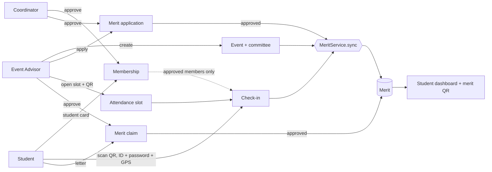
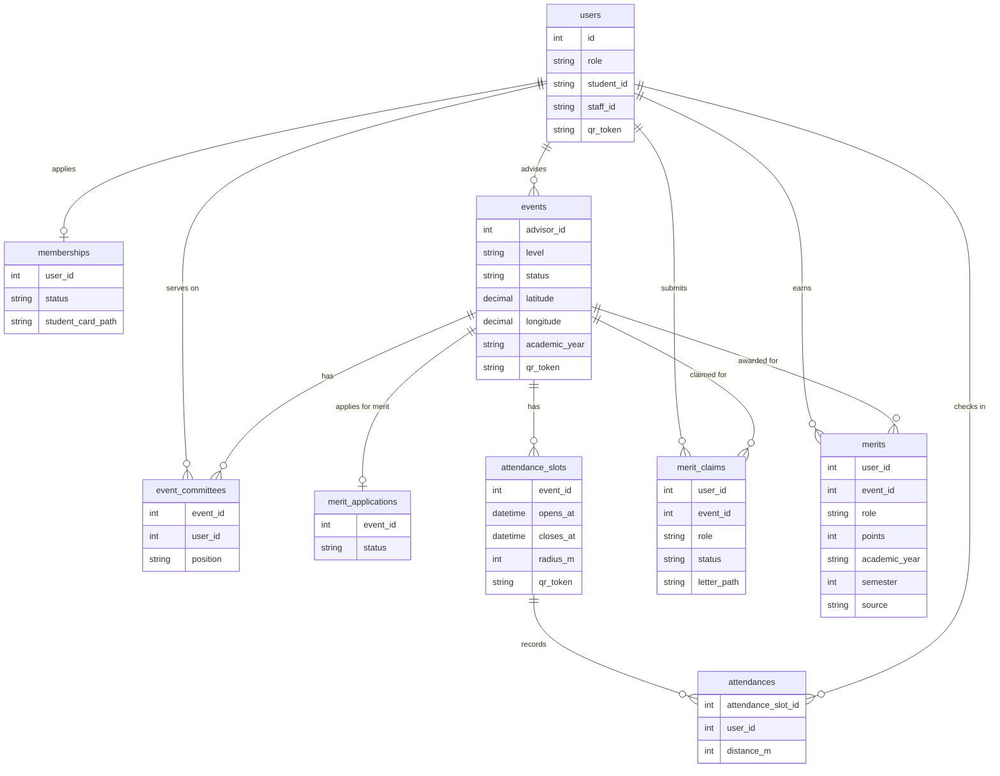

# MyPetakom

Web-based management system for **Persatuan Petakom, FK UMPSA**. It covers student membership, event management, location-verified attendance and a merit system, with a separate dashboard for each of three roles.

Built with Laravel 12, Blade, Tailwind CSS, Alpine.js and SQLite.

## Roles

| Role | What they do |
|---|---|
| **Student** | Apply for membership with a student card, view merit and a personal merit QR, check in to events, submit merit claims, see a dashboard with merit charts. |
| **Event Advisor** | Create and manage events (with map location, approval letter, committee), apply for event merit, open attendance slots with QR codes, review merit claims for their own events. |
| **Petakom Coordinator** | Approve or reject memberships and merit applications, manage all user accounts, view attendance and an overview dashboard, run SQL-backed reports. |

## Modules

1. **Membership and users**: registration, login by email / student ID / staff ID, profile with avatar, membership review, coordinator-managed accounts (create, edit, deactivate, delete).
2. **Events and merit applications**: events with level, location and committee, approval letters, public event page with QR, merit application and coordinator review.
3. **Attendance**: time-windowed slots with a QR code (optionally rotating every 30 seconds, so a photo of the QR cannot be shared with people who are not at the venue), public check-in that checks student ID, password, approved membership, the time window and the student's GPS distance to the venue (Haversine).
4. **Merit**: scores by event level and role (`config/merit.php`), merit awarded automatically and idempotently from approved applications, merit claims for missing merit (draft, submitted, approved or rejected), student merit page and public merit QR.

Also: a month calendar of events for every role, in-app notifications (bell in the topbar), custom error pages, and Chart.js dashboards with an accessible "View as table" for each chart.

## How the modules fit together



Merit is awarded in one place (`MeritService`). It is idempotent: an approved merit application on a non-cancelled event gives the committee and the attendees their points, and running it again changes nothing.

## Database



## Merit scores

| Level | Committee: Main | Committee | Participant |
|---|---|---|---|
| International | 100 | 70 | 50 |
| National | 80 | 50 | 40 |
| State | 60 | 40 | 30 |
| District | 40 | 30 | 15 |
| UMPSA | 30 | 20 | 5 |

Defined in `config/merit.php`.

## Security notes

- Role access is enforced by the `role:` middleware on every route group, and by policies (`EventPolicy`, `AttendanceSlotPolicy`, `MeritClaimPolicy`) for per-record access.
- Student cards, approval letters and claim letters are stored on the private disk and served only through authorised routes.
- Deactivated accounts cannot log in and are logged out of active sessions.
- Login is rate limited; public check-in is throttled (20 per minute).
- All forms use CSRF tokens; uploads are validated by type and size.
- Important actions (approvals, rejections, deletions, account changes) are written to an audit trail that only the coordinator can read (`Activity Log`). The actor's name is copied into each row, so it survives account deletion.
- `tests/Feature/RoleAccessTest.php` checks every protected page against every role.

## Run locally

Requirements: PHP 8.2+, Composer, Node 18+.

```bash
composer install
cp .env.example .env
php artisan key:generate
touch database/database.sqlite      # SQLite file (Windows: type nul > database\database.sqlite)
php artisan migrate --seed
php artisan storage:link
npm install
npm run dev                         # or: npm run build
php artisan serve
```

Open http://localhost:8000.

### Demo accounts (password: `password`)

| Role | Email |
|---|---|
| Coordinator | coordinator@petakom.test |
| Advisor | advisor@petakom.test |
| Student (no membership yet) | student@petakom.test |

The seeder also creates 14 students with memberships in different states, 5 events, merit applications, attendance for past events and sample merit claims.

> The check-in page uses the browser's geolocation, which needs HTTPS or `localhost`.

## Deploy

A `Dockerfile` is included, so any host that builds from Docker works (Railway, Render, Fly.io and similar).

1. Create a new web service from this repository (Docker build).
2. Set the environment variables from `.env.production.example`. Generate `APP_KEY` with `php artisan key:generate --show`, and set `APP_URL` to your public HTTPS address.
3. Deploy. On start, `docker/start.sh` creates the SQLite file, runs migrations, seeds the demo data the first time, caches config and routes, and serves the app on `$PORT`.

Notes:
- SQLite lives inside the container. Without a persistent volume, data resets on every redeploy. That is fine for a portfolio demo. For lasting data, mount a volume and point `DB_DATABASE` to it. Uploaded files (`storage/app`) need a volume too.
- HTTPS is forced in production, and the proxy is trusted, so secure cookies and the check-in geolocation work behind the host's TLS.
- Forgot-password e-mails are written to the log (`MAIL_MAILER=log`) until a real mail service is configured.

## Tests

```bash
php artisan test
```

Feature tests cover authentication, profile, membership, user accounts, dashboards, events, merit applications, attendance, merit, notifications and role access.

## Project layout

```
app/Http/Controllers/   controllers per feature (Coordinator/ for admin-only)
app/Policies/           per-record authorisation
app/Services/           MeritService (idempotent merit awarding)
app/Support/            Menu (per-role sidebar), Qr, Geo
config/merit.php        merit scores
resources/views/        Blade views, components and layouts
resources/js/charts.js  Chart.js setup (lazy-loaded)
```
